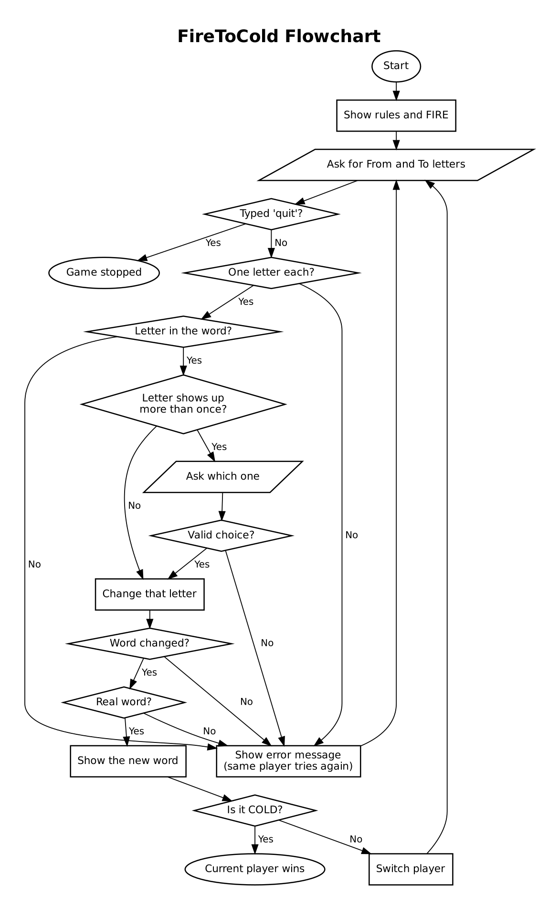

# FireToCold

A two-player **word ladder** game in the terminal. Start with **FIRE** and change one letter at a time to reach **COLD**. Every step has to be a real word.

## Features

- Two players take turns, and whoever makes **COLD** wins
- Every move is checked against a list of 1,935 four-letter words
- If a letter shows up twice (like the O's in FOOD), it asks which one to change
- Bad moves don't cost a turn: the same player just tries again
- Handles bad input without crashing (more than one letter, a letter not in the word, no change, a word that doesn't exist)
- Type `quit` at any time to stop the game

## How to run

You need Python 3.6 or newer. Keep `firetocold.py` and `words.py` in the same folder.

```bash
python firetocold.py
```

Then type the letter you want to change (**From**) and the letter you want instead (**To**).

## Example

```
Welcome to the FireToCold Game!
Rules:
1. 2 Player Game
2. Change One Letter at a Time
3. Spell the Word 'COLD'
Type 'quit' to stop the game.

FIRE
Player 1
What letter do you want to change:
From: I
To: O
FORE
Player 2
What letter do you want to change:
From: E
To: X
Word does not exist
Player 2
What letter do you want to change:
From: E
To: D
FORD
Player 1
What letter do you want to change:
From: R
To: O
FOOD
Player 2
What letter do you want to change:
From: O
To: L
There are 2 O's. Which one? (1 = first, 2 = second...): 2
FOLD
Player 1
What letter do you want to change:
From: F
To: C
COLD
Player 1 wins!
```

## How it works

Every move goes through a list of checks. If any check fails, the game shows an error and the same player tries again:

```
From and To  ->  checks  ->  new word  ->  is it COLD?
```

| Check | Error message |
|---|---|
| Is it one letter each? | `Enter only one letter` |
| Is the letter in the word? | `Letter does not exist` |
| If the letter is there twice, is the choice valid? | `Invalid choice` |
| Did the word actually change? | `Choose a different letter` |
| Is it a real word? | `Word does not exist` |

**Changing the letter:**
- The game finds every spot where the letter shows up in the word.
- It rebuilds the word with only that one spot changed, using slicing: `start[:position] + toletter + start[position + 1:]`
- This way FOOD can become FOLD (second O changed) and not FLOD.

**The word list:**
- `words.py` holds the words in a **set**, not a list. Checking if a word is in a set is instant, while a list has to look at every word one by one.

## Flowchart



A PDF version is in [`FireToCold_FlowChart.pdf`](FireToCold_FlowChart.pdf).

## Notes

- The shortest win takes 4 moves: FIRE → FORE → CORE → COLE → COLD.
- Players can go back to a word that was already used, so a game can go in circles until someone types `quit`.
- Some real words might be missing from the list. If a real word gets rejected, add it to `words.py`.

## What I learned

- Using `continue` to skip the rest of a loop and let the player try again
- Using string slicing to change one letter at a specific spot
- Why a set is faster than a list for checking if something exists
- Keeping data (the word list) in its own file and importing it

## Ideas for later

- Add a hint that shows the best next move, using breadth-first search (BFS)
- Pick a random start and end word every game
- Count the moves and compare with the shortest possible path
- Stop players from going back to a word that was already used
- Add a one-player mode against the computer
